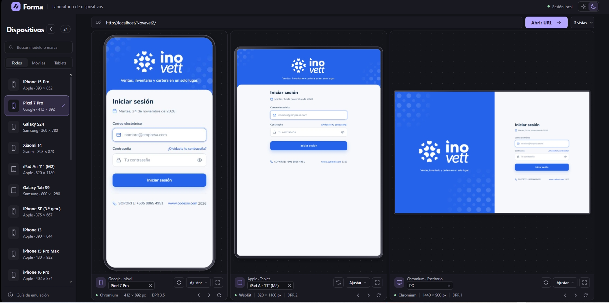

# UITESTER · Laboratorio de dispositivos

## Captura de pantalla



Creado por Julio Pasquier el 21 de noviembre de 2026. Distribuido bajo la [licencia MIT](LICENSE).

UITESTER permite probar aplicaciones web en perfiles de móviles, tablets y escritorio, con hasta tres vistas sincronizadas. Usa JavaScript, HTML y CSS en la interfaz, Node.js para el motor local y Playwright con Chromium y WebKit para la emulación.

## Instalación rápida en Windows

1. Instala Node.js 20 o superior desde [nodejs.org](https://nodejs.org/).
2. En GitHub, pulsa **Code → Download ZIP** y extrae la carpeta completa.
3. Abre **Iniciar.cmd**. La primera vez descarga las dependencias y los navegadores. Necesita conexión a Internet.
4. Espera a que se abra UITESTER en el navegador. Conserva abierta la ventana del motor mientras lo usas.

En los siguientes usos, abre **Iniciar.cmd**. Si la descarga falla, comprueba tu conexión y vuelve a abrirlo. La instalación con el lanzador funciona sin Laragon ni base de datos.

Abre **Iniciar.cmd** en Windows. El lanzador abre el laboratorio en [127.0.0.1:4317](http://127.0.0.1:4317/) o en [127.0.0.1:4318](http://127.0.0.1:4318/) si el primero está ocupado por una versión anterior. Las vistas abiertas siguen en el motor que las creó. También puedes iniciar el puerto 4317 desde esta carpeta con `npm start`. [La entrada de Laragon](http://localhost/apptest/) abre el motor disponible y da prioridad a la versión actual.

## Probar una aplicación

1. Escribe la URL que funciona desde tu PC. Puedes usar un dominio público, un dominio de Laragon, `localhost:8000` o una IP como `192.168.1.25:8080/app`. Conserva el puerto si tu aplicación lo requiere.
2. Pulsa **Abrir URL**. En el catálogo puedes buscar por modelo o marca y filtrar móviles o tablets.
3. El círculo sigue el puntero y marca el punto de toque. Haz clic para tocar, escribe en los campos y usa la rueda o arrastra para desplazarte. Las barras indican la posición en la página o el panel que estás desplazando.
4. Los botones de sol y luna cambian el tema del laboratorio. El navegador recuerda el tema y el modelo elegidos.

Los nombres públicos sin protocolo usan HTTPS. Las IP privadas, los nombres de PC, `localhost` y los dominios con sufijo `.test`, `.local` o `.lan` usan HTTP de forma predeterminada. Puedes indicar explícitamente HTTP o HTTPS. El dominio debe resolverse en la PC y el servidor de destino debe estar en ejecución.

## Comparar dispositivos

El selector **Comparar**, junto al campo de URL, activa **2 vistas** o **3 vistas**. Cada panel tiene su propio modelo, giro y escala. En tres vistas, la tercera empieza con el perfil de PC. Elige **1 vista** para cerrar la comparación.

Arrastra un separador vertical para repartir el ancho entre dos vistas. Los tiradores de los extremos amplían la primera o la última vista hacia el margen disponible. El tirador inferior cambia la altura del panel. También puedes enfocar un tirador y usar las flechas. Haz doble clic o pulsa Inicio para restaurar el tamaño.

La navegación y el desplazamiento se comparten. Los clics y la escritura se replican cuando UITESTER encuentra un control equivalente en los otros paneles. La comparación usa sesiones de navegador independientes y las acciones de una vista pueden ejecutarse también en las demás.

## Emulación

El servicio escucha solo en la interfaz de bucle local. Playwright abre cada aplicación en un contexto de navegador independiente y envía su imagen al panel. Así se pueden probar páginas que impiden mostrarse en un iframe. Los modelos Apple usan WebKit y los Android usan Chromium. Las medidas son perfiles de pantalla completa en píxeles CSS. La densidad, el zoom de pantalla y las barras del navegador del dispositivo físico pueden cambiar el área disponible.

Al girar el dispositivo se conserva la página abierta. Al cambiar de modelo se vuelve a cargar su URL en un nuevo contexto con las cookies, el almacenamiento local y el almacenamiento de la pestaña del sitio abierto. Termina de escribir o guardar en la aplicación antes de cambiar de modelo. Si recargas UITESTER en la misma pestaña, se recuperan las vistas y su página abierta mientras sus sesiones sigan activas en el motor local. UITESTER libera las sesiones tras 20 minutos sin actividad y las aplicaciones pueden aplicar sus propios tiempos de vencimiento.

El panel muestra los fotogramas que envía el motor emulado cuando se actualiza la vista. Las pruebas de fluidez, gestos multitáctiles, cámara, audio, teclado nativo y Safari en un iPhone físico requieren el dispositivo correspondiente.

Marca **GPU** en la barra superior y pulsa **Abrir URL** para usar aceleración por hardware en los perfiles de Chromium. UITESTER comprueba la GPU al iniciar el motor y vuelve al modo estándar si no está disponible. El pie de la vista muestra el estado. Cambiar el ajuste requiere abrir la URL de nuevo y conserva las cookies y el almacenamiento del sitio.

En **Configuración**, elige una vista para cambiar el ancho y alto en píxeles CSS, el DPR o la calidad de captura. Cambiar el DPR recarga la vista y conserva las cookies y el almacenamiento del sitio. **Captura nítida** usa JPEG de mayor calidad y muestra píxeles físicos en Chromium cuando el DPR es mayor que 1. En estos casos la frecuencia máxima de captura se reduce para controlar el consumo de recursos. Usa **Restaurar perfil** y **Aplicar** para recuperar los valores originales.

Si abres directamente el proyecto en Apache sin el motor local, la interfaz ofrece una vista adaptable en iframe con el motor de tu navegador. Un sitio puede impedir esta vista mediante sus políticas de marcos. Abre **Iniciar.cmd** para usar los motores del laboratorio.

## Instalación desde una terminal

Requiere Node.js 20 o posterior. Para preparar ambos motores desde esta carpeta:

```powershell
npm ci
npx playwright-core install chromium webkit
npm start
```

Después abre la dirección local que muestra el servidor. El repositorio se puede publicar en GitHub. Para usar los motores de emulación, ejecuta la aplicación en una computadora con Node.js y los navegadores de Playwright instalados.

## Verificación

`npm test` prueba el procesamiento de direcciones. Con el laboratorio iniciado y los motores de Playwright instalados, `node tests/browser.mjs` verifica la interfaz y los perfiles contra páginas temporales de prueba. Utiliza localhost y una IP privada de la PC si está disponible.

